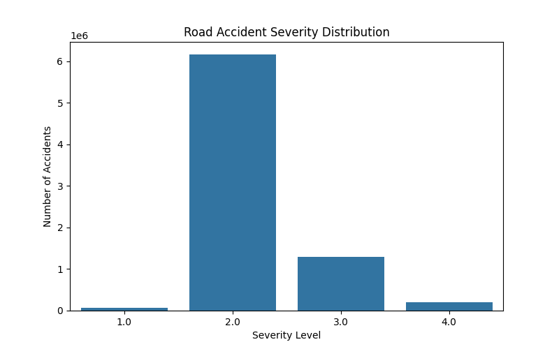
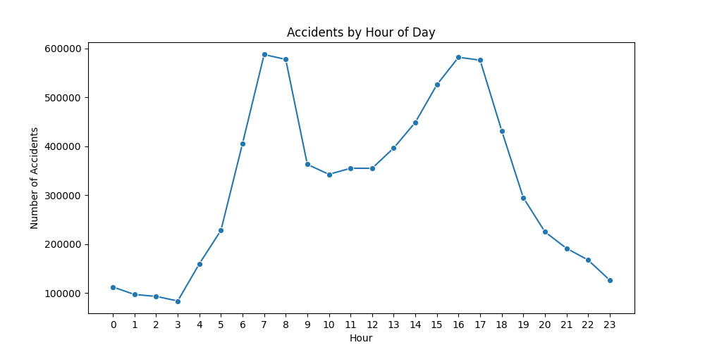
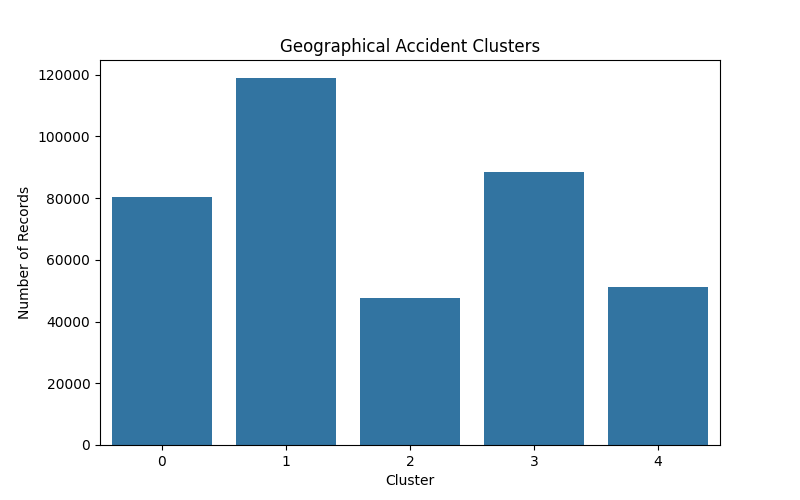

# 🚦 Smart Traffic Accident Analysis System

### Big Data Analytics and Machine Learning Project

## 📌 Project Overview

The Smart Traffic Accident Analysis System is a Big Data and Machine Learning application designed to analyze historical road accident records, discover geographical accident patterns, and predict accident severity.

The project uses Apache Spark and PySpark for large-scale data processing and machine learning algorithms for accident pattern analysis.

## 🎯 Objectives

- Analyze historical road accident data.
- Identify accident severity patterns.
- Analyze accidents based on time and location.
- Identify geographical accident clusters.
- Predict accident severity using Machine Learning.
- Generate meaningful visualizations.

## 📂 Dataset Information

- **Dataset:** US Accidents (March 2023)
- **Source:** Kaggle
- **Format:** CSV
- **Dataset URL:** https://www.kaggle.com/datasets/sobhanmoosavi/us-accidents

### Important Dataset Features
- Severity
- Start_Time
- Start_Lat and Start_Lng
- Temperature
- Humidity
- Visibility
- Wind_Speed
- Weather_Condition
- Traffic_Signal
- Junction
- Crossing

## 🛠️ Technologies Used

| Technology | Purpose |
|---|---|
| Python | Programming |
| Apache Spark 3.5.3 | Big Data Processing |
| PySpark | Distributed Data Processing |
| Spark SQL | Data Analysis |
| Spark MLlib | Machine Learning |
| Pandas | Data Handling |
| Matplotlib | Visualization |
| Seaborn | Statistical Graphs |
| Google Colab | Development Environment |
| GitHub | Version Control |

## 🧠 Machine Learning Algorithms

### 1. K-Means Clustering
Used to group geographical accident locations using latitude and longitude coordinates.

The implementation identifies five clusters.

### 2. Random Forest Classifier
Used to classify accident severity based on weather, geographical, and time-related features.

A weighted Random Forest model is also implemented to address class imbalance.

## ⚙️ Project Workflow

1. Dataset Collection
2. Dataset Loading
3. Data Preprocessing
4. Big Data Processing using PySpark
5. Accident Analysis using Spark SQL
6. K-Means Clustering
7. Random Forest Classification
8. Model Evaluation
9. Data Visualization

## 📊 Project Outputs

### Accident Severity Distribution

### Accident Analysis by Hour

### Geographical Accident Clusters

## 📈 Implementation Results

- Successfully loaded the accident dataset into Apache Spark.
- Performed data preprocessing using PySpark.
- Analyzed accident severity and accident frequency.
- Identified five geographical clusters using K-Means.
- Trained Random Forest and weighted Random Forest models.
- Saved trained models in Google Drive.
- Generated analytical visualizations.

## 🚀 Future Enhancements

- Real-time traffic data integration.
- Interactive accident hotspot maps.
- Improved severity prediction.
- Live traffic monitoring integration.
- Advanced machine learning techniques.

## 🏁 Conclusion

This project demonstrates the application of Big Data Analytics and Machine Learning in road accident analysis. Apache Spark enables large-scale data processing, while K-Means and Random Forest provide geographical clustering and accident severity classification.

The system can support data-driven road safety analysis and help identify important accident patterns.

---

**Developed by:** Rohith Chinta

**Project Domain:** Big Data Analytics and Machine Learning
